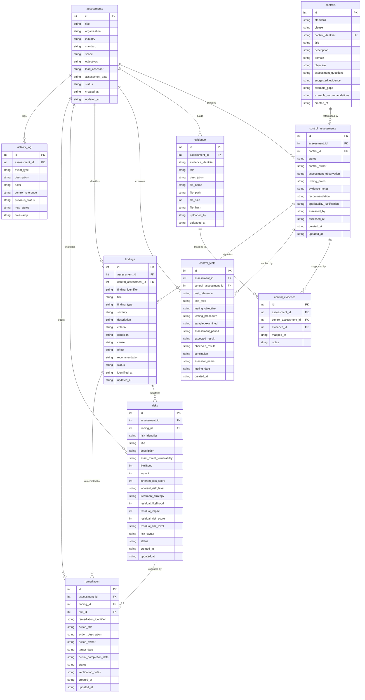

# AuditSphere Architecture Documentation

## 1. System Overview

AuditSphere is a portfolio-grade Governance, Risk and Compliance (GRC) platform engineered to simulate an **ISO/IEC 27001:2022** assessment lifecycle. The system provides structured assessment workspace management, Annex A security control evaluation, evidence traceability, gap analysis, qualitative risk registers, and remediation workflows.

```
+-------------------------------------------------------------+
|                     Streamlit UI Shell                      |
|  (App Router, Persistent Sidebar, Theme Engine, Layouts)   |
+-------------------------------------------------------------+
                              |
                              v
+-------------------------------------------------------------+
|                       Service Layer                         |
|   (AssessmentService, ControlService, AssessmentEngine,     |
|             DashboardService, ActivityService)              |
+-------------------------------------------------------------+
                              |
                              v
+-------------------------------------------------------------+
|                     Data Access Layer                       |
|   (SQLite Parameterized Engine, Transactions, WAL Mode)     |
+-------------------------------------------------------------+
                              |
                              v
+-------------------------------------------------------------+
|                   SQLite Relational Store                   |
|       (Foreign Keys ON, Cross-Assessment Triggers)          |
+-------------------------------------------------------------+
```

---

## 2. Architectural Design Principles

1. **Simplicity and Modularity**: Clear separation of user interface rendering (`pages/`, `ui_components.py`), domain services (`services/`), and data storage (`database.py`).
2. **Defensive Data Integrity**:
   - Parameterized SQL execution exclusively (`?` placeholders) to eliminate SQL injection vulnerabilities.
   - Enforced SQLite foreign keys (`PRAGMA foreign_keys = ON;`) on every connection.
   - Write-Ahead Logging (`PRAGMA journal_mode = WAL;`) for high concurrency.
   - Cross-assessment relational isolation enforced via database triggers to prevent linking artifacts across distinct assessment boundaries.
   - Archived assessments are strictly protected against modification.
3. **Authentic GRC Metrics & Scoring Engine**:
   - Deterministic calculations implemented via pure functions in `services/assessment_engine.py`.
   - Coverage: $\frac{\text{Assessed Applicable}}{\text{Total Applicable}} \times 100$.
   - Weighted Readiness: $\frac{\text{Implemented} + 0.5 \times \text{Partially Implemented}}{\text{Assessed Applicable}} \times 100$.
   - Zero hardcoded or simulated percentages; unassessed assessments display `N/A`.
4. **Idempotency & Repeat-Safe Operations**:
   - Schema creation and column migrations run repeat-safely.
   - Control catalogue (`data/controls.json`) synchronizes without overwriting custom observations.
   - Fictional demonstration dataset (FinCore Technologies) can be generated repeatedly without duplicate assessment pollution.
5. **Portability**: Uses exclusively free and open-source libraries (Python, Streamlit, SQLite, Pandas, Plotly, Pytest).

---

## 3. Database Schema & Entity-Relationship Model



---

## 4. Cross-Assessment Relational Isolation Triggers

To prevent evidence, findings, and risks from one assessment accidentally becoming mapped to another assessment, SQLite triggers are compiled directly into the database engine:

1. `trg_prevent_cross_assessment_control_evidence_insert / update`: Aborts operation if `control_assessments.assessment_id != NEW.assessment_id` or `evidence.assessment_id != NEW.assessment_id`.
2. `trg_prevent_cross_assessment_control_test_insert / update`: Aborts operation if `control_assessments.assessment_id != NEW.assessment_id`.
3. `trg_prevent_cross_assessment_finding_insert / update`: Aborts operation if `control_assessments.assessment_id != NEW.assessment_id`.
4. `trg_prevent_cross_assessment_risk_insert / update`: Aborts operation if `findings.assessment_id != NEW.assessment_id`.
5. `trg_prevent_cross_assessment_remediation_insert / update`: Aborts operation if `findings.assessment_id != NEW.assessment_id` or `risks.assessment_id != NEW.assessment_id`.

---

## 5. Control Evaluation State Machine

```
   +---------------------+
   |    Not Assessed     | (Initial state)
   +----------+----------+
              |
              +-------------------+--------------------+
              |                   |                    |
              v                   v                    v
     +-----------------+  +-----------------+  +----------------+
     |   Implemented   |  |   Partially     |  | Not Applicable |
     | (Observation    |  |  Implemented    |  | (Justification |
     |  Required)      |  | & Not Implem.   |  |  Required)     |
     +-----------------+  | (Obs + Rec Req) |  +----------------+
                          +-----------------+
```

---

## 6. Phase 3 Working-Paper Assurance Architecture

Phase 3 implements end-to-end audit traceability from control implementation to corroborated finding:

```
[ Annex A Control ] <---(many-to-many)---> [ Mapped Evidence Files ]
        |                                             |
        v                                             |
[ Control Test (Design/Operating) ]                   |
        |                                             |
        v                                             v
[ Corroborated Audit Finding (CCCER: Criteria, Condition, Cause, Effect, Recommendation) ]
```

### Key Components:
- **Evidence Manager (`services/evidence_manager.py`):** Ingestion validation (magic bytes, extensions, size), SHA-256 integrity verification, safe storage path traversal defense, and 4-tier review workflow (`Pending Review`, `Accepted`, `Needs Clarification`, `Rejected`).
- **Gap & Findings Engine (`services/gap_engine.py`):** Structured testing documentation, diagnostic gap detection (failed tests, partial implementations, evidence deficiencies), formal CCCER finding creation, and verified closure governance.
- **Evidence Management Workspace (`pages/evidence_page.py`):** Centralized file repository, audit review actions, and SHA-256 integrity check controls.
- **Gap Analysis & Findings Workspace (`pages/gap_analysis_page.py`):** Deficiency diagnostics, formal findings directory, promotion workflow, and working-paper traceability matrix.

---

## 7. Phase 4 Risk Management & Scoring Engine Architecture

Phase 4 establishes an integrated Risk Register and qualitative Risk Evaluation Engine linking risks directly to assessed controls, formal findings, and supporting evidence:

```
[ Formally Confirmed Finding ] <----\
[ Annex A Security Control   ] <-----+----[ Identified Risk Record ]
[ Cryptographic Evidence     ] <----/          |
                                               v
                                   [ Three-Tier Evaluation ]
                                   - Inherent (Pre-Control)
                                   - Current Residual (Active Posture)
                                   - Target Residual (Post-Treatment)
                                               |
                                               v
                                   [ 5x5 Likelihood x Impact Heatmap ]
                                   [ Reassessment Review Ledger      ]
```

### Key Components:
- **Risk Scoring Engine (`services/risk_engine.py`):**
  - Pure calculation functions for risk scoring ($S = L \times I$), severity boundaries (Low 1–5, Medium 6–11, High 12–19, Critical 20–25), and explicit unassessed handling (`Score = None`, `Severity = "Not Assessed"`).
  - 3-tier evaluation comparison logic ensuring target residual risk never overwrites current residual risk.
  - 5×5 Plotly heatmap coordinate aggregation for Inherent, Current Residual, and Target Residual matrices.
  - CSV export sanitization neutralizing formula execution characters (`=`, `+`, `-`, `@`, `\t`, `\r`) to mitigate CWE-1236.
  - Review cadence tracking identifying overdue risk evaluations based on residual severity.
- **Risk Service (`services/risk_service.py`):**
  - Full CRUD lifecycle management for risks (`Identified`, `Under Assessment`, `Open`, `Treatment Planned`, `Under Treatment`, `Under Review`, `Accepted`, `Closed`).
  - Automated reassessment detection snapshotting previous vs. new ratings to `risk_reviews`.
  - Transactional governance enforcement: `Accepted` requires documented justification and `Approved` status; `Closed` requires `closure_rationale`.
  - Many-to-many relationship management linking risks to findings, controls, and evidence with cross-assessment trigger protection.
- **Risk Register Workspace (`pages/risk_page.py`):**
  - 4-tab enterprise interface: Filterable Table & Metric Cards, Interactive 5×5 Plotly Heatmap with Cell Inspector, 5-Section Risk Entry/Evaluation Form, and Working Paper Detail View.
- **Relational Integrity Triggers:**
  - `trg_prevent_cross_assessment_risk_finding_insert / update`
  - `trg_prevent_cross_assessment_risk_control_insert / update`
  - `trg_prevent_cross_assessment_risk_evidence_insert / update`
  - `trg_prevent_cross_assessment_risk_review_insert / update`

---

## 8. Phase 5 Remediation & Corrective Action Architecture

Phase 5 completes the end-to-end ISMS assessment governance lifecycle by implementing an audited Corrective Action Tracker, Root Cause Analysis engine (5 Whys), Progress & Deadline Extension ledgers, and Effectiveness Verification system:

```
[ Assessment ] ---> [ Control Evaluation ] ---> [ Evidence ] ---> [ Control Test ]
                                                                          |
                                                                          v
[ Finding Closed ] <--- [ Finding Confirmed ] <---------------------------+
       ^                         |
       |                         v
       |                  [ Risk Register ]
       |                         |
       |                         v
       |            [ Corrective Action (ACT) ]
       |             - Containment vs Long-Term
       |             - Root Cause (5 Whys)
       |             - Progress Tracking (0-100%)
       |             - Deadline Extensions
       |                         |
       |                         v
       |            [ Effectiveness Verification ]
       |             (Effective / Ineffective)
       |                         |
       +--- Must Be Effective ---+
```

### Key Components:
- **Remediation Engine (`services/remediation_engine.py`):**
  - Pure deterministic validation functions: `validate_status_transition`, `validate_closure_eligibility`, `validate_priority_alignment`, and `suggest_priority_from_source`.
  - Comprehensive metrics calculator (`calculate_remediation_metrics`) tracking active actions, overdue count, due today, due in 7 days, completed on time, and verified closure rate ($\frac{\text{Closed}}{\text{Total} - \text{Cancelled}} \times 100$).
  - CWE-1236 CSV export sanitization neutralizing formula execution characters.
- **Remediation Service (`services/remediation_service.py`):**
  - Full transactional lifecycle management: `create_remediation`, `update_remediation`, `record_progress_update`, `extend_deadline`, `record_verification`, `close_remediation`, `reopen_remediation`, `cancel_remediation`, and `archive_remediation`.
  - Many-to-many relationship management across findings, risks, controls, and evidence artifacts.
  - Relational isolation enforcing that archived assessments cannot mutate corrective actions or verification ledgers.
- **Remediation Tracker Workspace (`pages/remediation_page.py`):**
  - 4-tab enterprise interface:
    - **Tab 1: Directory & Register:** Multi-criteria filterable directory, telemetry KPI cards, and CSV export.
    - **Tab 2: Corrective Action Form:** 5-section entry form with interactive 5 Whys dynamic builder, priority alignment validator, and relationship selectors.
    - **Tab 3: Working Paper & Detail View:** Full CCCER finding traceability grid, 5 Whys sequence viewer, progress timeline, deadline extensions ledger, and verification record history.
    - **Tab 4: Lifecycle & Governance Actions:** Progress logging, formal deadline extension requests, independent effectiveness verifications, formal closure, reopening, and cancellation.
- **Relational Child Tables & Triggers:**
  - `remediation_findings`, `remediation_risks`, `remediation_controls`, `remediation_evidence`
  - `remediation_progress`, `remediation_deadline_extensions`, `remediation_verifications`
  - Cross-assessment triggers preventing any cross-assessment foreign relationships:
    - `trg_prevent_cross_assessment_remediation_finding_insert / update`
    - `trg_prevent_cross_assessment_remediation_risk_insert / update`
    - `trg_prevent_cross_assessment_remediation_control_insert / update`
    - `trg_prevent_cross_assessment_remediation_evidence_insert / update`
    - `trg_prevent_cross_assessment_remediation_progress_insert / update`
    - `trg_prevent_cross_assessment_remediation_deadline_ext_insert / update`
    - `trg_prevent_cross_assessment_remediation_verif_insert / update`

