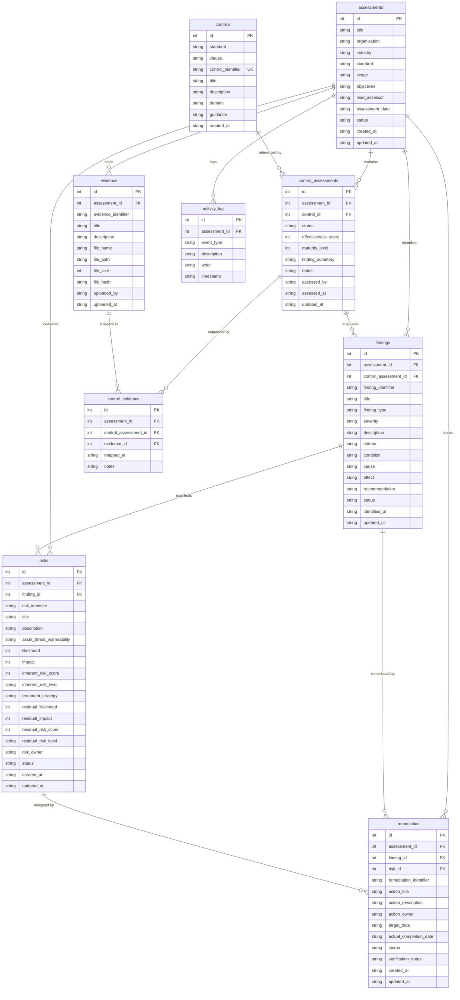

# AuditSphere Architecture Documentation

## 1. System Overview

AuditSphere is a portfolio-grade Governance, Risk and Compliance (GRC) platform engineered to simulate an ISO/IEC 27001:2022 assessment lifecycle. The system provides structured assessment workspace management, evidence traceability, gap analysis, qualitative risk registers, and remediation workflows.

```
+-------------------------------------------------------------+
|                     Streamlit UI Shell                      |
|  (App Router, Persistent Sidebar, Theme Engine, Layouts)   |
+-------------------------------------------------------------+
                              |
                              v
+-------------------------------------------------------------+
|                       Service Layer                         |
|  (AssessmentService, DashboardService, ActivityService)     |
+-------------------------------------------------------------+
                              |
                              v
+-------------------------------------------------------------+
|                     Data Access Layer                       |
|   (SQLite Parameterized Engine, Transactions, WAL Mode)     |
+-------------------------------------------------------------+
                              |
                              v
+-------------------------------------------------------------+
|                   SQLite Relational Store                   |
|       (Foreign Keys ON, Cross-Assessment Triggers)          |
+-------------------------------------------------------------+
```

---

## 2. Architectural Design Principles

1. **Simplicity and Modularity**: Clear separation of user interface rendering (`pages/`, `ui_components.py`), domain services (`services/`), and data storage (`database.py`).
2. **Defensive Data Integrity**:
   - Parameterized SQL execution exclusively (`?` placeholders) to eliminate SQL injection vulnerabilities.
   - Enforced SQLite foreign keys (`PRAGMA foreign_keys = ON;`) on every connection.
   - Write-Ahead Logging (`PRAGMA journal_mode = WAL;`) for concurrent read access.
   - Cross-assessment relational isolation enforced via database triggers to prevent linking artifacts across distinct assessment boundaries.
3. **Auditability & Traceability**: System activity logs recorded on assessment creation, modification, and archival.
4. **Authentic GRC Metrics**: No simulated, random, or hardcoded compliance percentages; every dashboard metric reflects actual database records.
5. **Portability**: Uses exclusively free and open-source standard libraries without external cloud dependencies or paid APIs.

---

## 3. Database Schema & Entity-Relationship Model



---

## 4. Cross-Assessment Relational Isolation Triggers

To prevent evidence, findings, and risks from one assessment accidentally becoming mapped to another assessment, SQLite triggers are compiled directly into the database engine:

1. `trg_prevent_cross_assessment_control_evidence_insert / update`: Aborts operation if `control_assessments.assessment_id != NEW.assessment_id` or `evidence.assessment_id != NEW.assessment_id`.
2. `trg_prevent_cross_assessment_finding_insert / update`: Aborts operation if `control_assessments.assessment_id != NEW.assessment_id`.
3. `trg_prevent_cross_assessment_risk_insert / update`: Aborts operation if `findings.assessment_id != NEW.assessment_id`.
4. `trg_prevent_cross_assessment_remediation_insert / update`: Aborts operation if `findings.assessment_id != NEW.assessment_id` or `risks.assessment_id != NEW.assessment_id`.

---

## 5. Session State & Context Architecture

The Streamlit front-end maintains the active assessment context through `st.session_state`:
- `st.session_state["active_assessment_id"]`: Stores the selected assessment ID.
- The sidebar selector provides persistent switching across any page.
- When no assessment exists, the dashboard cleanly displays empty states and prompts assessment creation.
