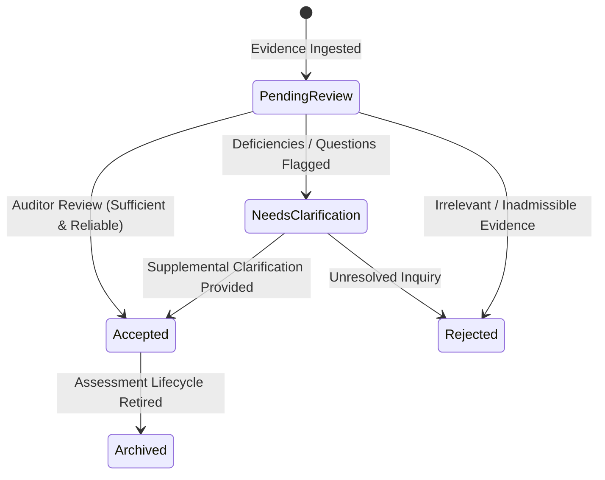

# AuditSphere – Evidence Management, Control Testing & Gap Analysis

> [!IMPORTANT]
> **Educational Simulation & Portfolio Disclaimer:**
> AuditSphere is an educational simulation and portfolio GRC software platform. It is **not** an accredited certification auditing system. Documenting evidence, performing testing, or logging findings within this tool does not constitute formal certification, external regulatory compliance, or accredited conformity with ISO/IEC 27001 or any legal standard.

---

## 1. Executive Summary

Phase 3 introduces an enterprise-grade assurance and working-paper lifecycle to AuditSphere. In information security auditing, an auditor's conclusions are only as defensible as the underlying working papers. Phase 3 provides an end-to-end audit chain:

$$\text{Security Control} \longrightarrow \text{Audit Evidence} \longrightarrow \text{Testing Record} \longrightarrow \text{Formal Finding (CCCER)}$$

Every finding is grounded in empirical verification, documented criteria, and referenced evidence or explicitly acknowledged evidence limitations.

---

## 2. Evidence Repository & Validation Architecture

### 2.1 File Ingestion and Format Controls

To defend against malicious payloads and corrupted files, AuditSphere enforces multi-layered ingestion validation:

1. **Extension Whitelist**: Only `.pdf`, `.png`, `.jpg`, `.jpeg`, `.csv`, `.txt`, and `.xlsx` are permitted. Executable binaries (`.exe`, `.bat`, `.sh`, `.cmd`, `.dll`, `.scr`) are rejected.
2. **Magic-Byte Signature Verification**: Files are inspected at the byte level before storage:
   - **PDF:** Must begin with `%PDF-` header.
   - **PNG:** Must match standard 8-byte signature `\x89PNG\r\n\x1a\n`.
   - **JPEG / JPG:** Must begin with SOI marker `\xff\xd8\xff`.
   - **XLSX:** Must match PKZip signature `PK\x03\x04`.
   - **Plain Text / CSV:** Must decode cleanly under UTF-8 or ASCII without binary null-byte injection.
3. **File Size Enforcement**: Configured default ceiling of 10 MB per artifact prevents disk exhaustion.

### 2.2 Storage Isolation and Path Traversal Defense

Uploaded files are never saved with their client-submitted filenames on the server filesystem. Instead:
- A cryptographic UUIDv4 is generated for every uploaded file: `{uuid4}.{ext}`.
- Files are segregated into assessment-specific directories: `storage/evidence/{assessment_id}/{storage_identifier}`.
- Path traversal defenses reject filenames containing `..`, `/`, `\`, or absolute path tokens.
- Resolved target paths are verified to reside strictly within the designated storage root.

### 2.3 SHA-256 Cryptographic Integrity vs. External Authenticity

AuditSphere computes and stores the SHA-256 hash of every uploaded artifact:

$$\text{SHA-256}(B) = H$$

> [!NOTE]
> **GRC Distinctions: Integrity vs. Authenticity vs. Effectiveness**
> - **Cryptographic Integrity:** Verifies that a local file stored on disk has not suffered bit-rot, corruption, or unauthorized modification after upload.
> - **External Authenticity:** Verifies that the artifact originated from a genuine, authoritative source (e.g. valid digital signature, tamper-proof system log). Cryptographic hash matching *does not* prove external authenticity.
> - **Control Effectiveness:** A genuine, uncorrupted policy document does *not* prove that personnel comply with it in daily operations.

AuditSphere enables auditors to trigger on-demand SHA-256 verification:
- **Verified:** Disk content hash matches the database baseline.
- **Hash mismatch:** Disk content has been modified or tampered with.
- **File missing:** Disk file was removed or deleted externally.

---

## 3. Auditor Evidence Review Workflow

Evidence uploaded to the repository enters a structured review lifecycle:

### Review Quality Attributes
- **Relevance:** Does the artifact directly address the Annex A control requirements?
- **Sufficiency:** Is the quantity and depth of the sample adequate to form an audit opinion?
- **Reliability:** Is the source credible, independent, and tamper-resistant?

Auditors cannot mark an artifact as *Accepted*, *Needs Clarification*, or *Rejected* without documenting their **Reviewer Name** and **Auditor Review Notes**.

---

## 4. Many-to-Many Control-Evidence Mapping

Audit artifacts frequently support multiple controls (for instance, an *Access Control Policy* supports both `A.5.15 Access control` and `A.5.18 Access permissions`).

- The junction table `control_evidence` manages many-to-many associations.
- **Cross-Assessment Isolation**: SQLite database triggers (`trg_prevent_cross_assessment_control_evidence` and `trg_prevent_cross_assessment_control_evidence_update`) reject any attempt to link evidence from Assessment A to a control assessment belonging to Assessment B.

---

## 5. Structured Control Testing Documentation

Testing records formalize how auditors verify that security controls operate as intended.

### 5.1 Test Types
- **Design Effectiveness:** Evaluating whether control procedures are appropriately formulated to mitigate risk.
- **Operating Effectiveness:** Sampling operational events over time to verify continuous execution.
- **Walkthrough:** Tracing a single transaction or access request from initiation to closure.
- **Document Review:** Reviewing policy approvals, meeting minutes, and architectural diagrams.
- **Configuration Review:** Auditing live settings, firewall rulesets, and identity provider policies.

### 5.2 Test Record Structure & Conclusions
Every test record captures:
1. `test_reference` (e.g. `TST-001`)
2. `test_type`
3. `testing_objective`
4. `testing_procedure`
5. `sample_examined` & `assessment_period`
6. `expected_result` & `observed_result`
7. `conclusion`: **Pass**, **Fail**, **Inconclusive**, or **Not tested**
8. `supporting_evidence_references`
9. `assessor_name` & `testing_date`

**Governance Rule:** Concluding a test as *Pass* or *Fail* strictly requires both documented expected and observed results.

---

## 6. Gap Analysis & Deficiency Engine

AuditSphere includes an automated diagnostic engine (`services/gap_engine.py`) that scans assessment records without altering manual auditor statuses:

1. **Implementation Gaps:** Controls evaluated as *Partially Implemented* or *Not Implemented*.
2. **Failed Tests:** Any test record concluding with *Fail*.
3. **Pending Controls:** Applicable controls remaining in *Not Assessed* state.
4. **Evidence Deficiencies:**
   - Applicable controls with zero mapped evidence.
   - Controls where evidence is pending review or was rejected.
   - Evidence records flagged with *Needs Clarification*.
   - Evidence records flagged with *Hash mismatch* integrity errors.
   - Control tests marked *Inconclusive*.

Auditors can review these diagnostic items in the Gap Analysis workspace and promote critical gaps directly into formal findings with a single click.

---

## 7. Formal CCCER Audit Findings Lifecycle

Formal findings represent corroborated audit non-conformities and observations.

### 7.1 The CCCER Framework

AuditSphere enforces the professional internal audit **CCCER** methodology:

| Element | Description | Enterprise Example |
| :--- | :--- | :--- |
| **Criteria** | The standard clause, policy requirement, or baseline | ISO/IEC 27001:2022 Control A.8.5 requires MFA on all external access ingress. |
| **Condition** | The factual observed reality discovered by the auditor | 12 contractor accounts access internal systems via legacy VPN without MFA. |
| **Cause** | Root cause explanation of why the deficiency exists | Legacy gateway was excluded from recent Okta migration due to deprecation delays. |
| **Effect / Impact** | Concrete business, technical, or regulatory risk exposure | High risk of credential stuffing and lateral movement into payment systems. |
| **Recommendation** | Constructive, actionable remediation guidance | Decommission legacy gateway and route all contractors through Okta SAML proxy. |

### 7.2 Evidence Traceability Governance
Every formal finding requires:
- Supporting evidence references (e.g. `EVD-002`) **OR**
- An explicitly documented evidence limitation explaining why direct evidence was unobtainable (e.g. "Third-party vendor refused SOC 2 report access; finding based on management inquiry").

### 7.3 Severity & Classification Taxonomy
- **Severities:** `Critical`, `High`, `Medium`, `Low`, `Informational`.
- **Finding Types:**
  - `Major Non-Conformity`: Fundamental breakdown in an ISO 27001 Annex A control requirement.
  - `Minor Non-Conformity`: Isolated or partial control lapse that does not compromise overall ISMS integrity.
  - `Opportunity for Improvement (OFI)`: Non-violating condition where security posture can be strengthened.
  - `Observation`: Informational finding noted for management awareness.

### 7.4 Closure Verification Standards
Findings transition through: `Draft` $\rightarrow$ `Open` $\rightarrow$ `Under Review` $\rightarrow$ `Closed`.
Closing a formal finding strictly requires documented **Verification Notes** detailing how corrective actions were verified by the auditor.

---

## 8. FinCore Technologies Demonstration Dataset

AuditSphere includes a pre-seeded, repeat-safe demonstration assessment (**FinCore Technologies Inc.**):

- **5 Fictional Audit Evidence Artifacts:**
  1. `FIN-POL-001_Access_Control_Policy_v3.2.txt` (Accepted, High Confidence, mapped to A.5.15, A.5.18).
  2. `FIN-CFG-002_Okta_MFA_Enforcement_Export.txt` (Accepted, High Confidence, mapped to A.8.5).
  3. `FIN-LOG-003_RDS_Restoration_Test_Failure.txt` (Accepted, High Confidence, mapped to A.8.13).
  4. `FIN-REC-004_FY26_Security_Awareness_Attendance.csv` (Needs Clarification, mapped to A.6.3).
  5. `FIN-REC-005_Privileged_Accounts_Inventory.txt` (Accepted, High Confidence, mapped to A.5.18).
- **1 Failed Operating Effectiveness Test (`TST-001` on Control `A.8.5`):**
  - Demonstrates password-only bypass for contractor accounts on legacy VPN.
- **1 Confirmed Major Non-Conformity Finding (`FND-001` on Control `A.8.5`):**
  - Fully articulated CCCER elements linked directly to `FIN-CFG-002` and `TST-001`.
